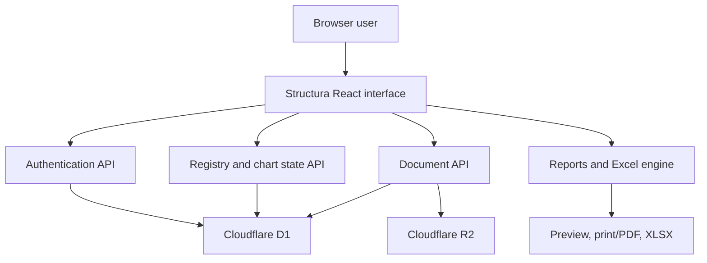
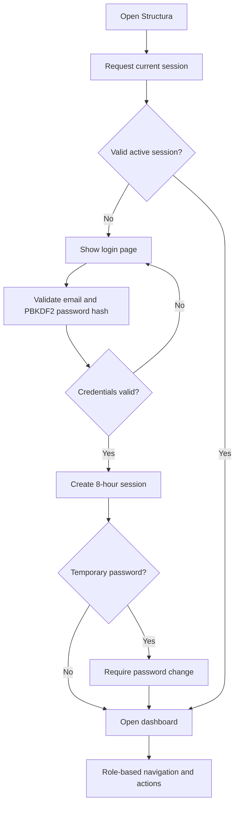
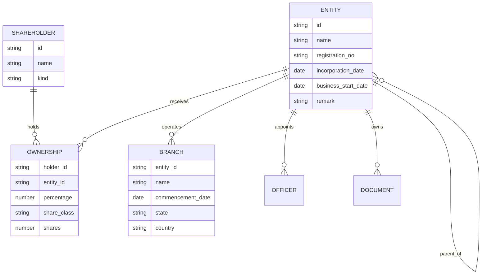
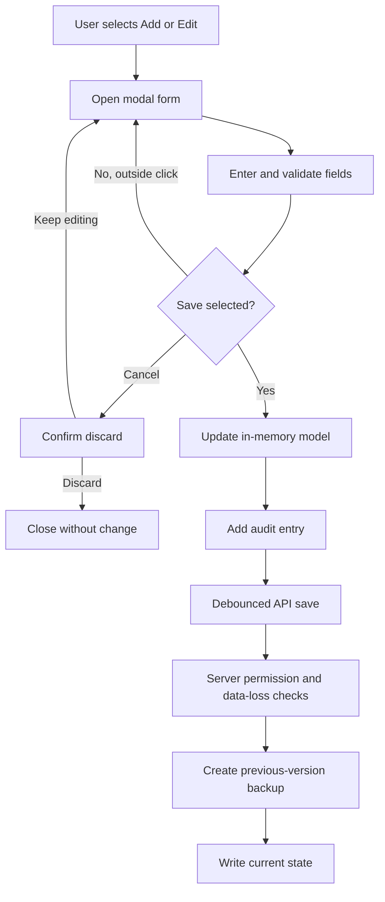
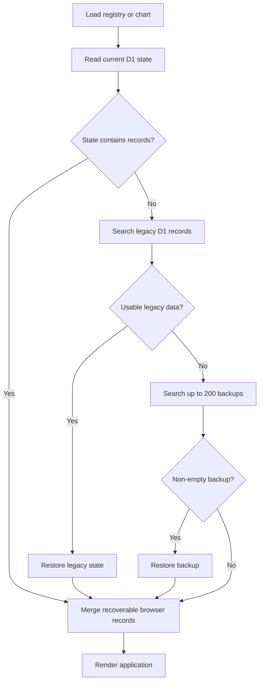
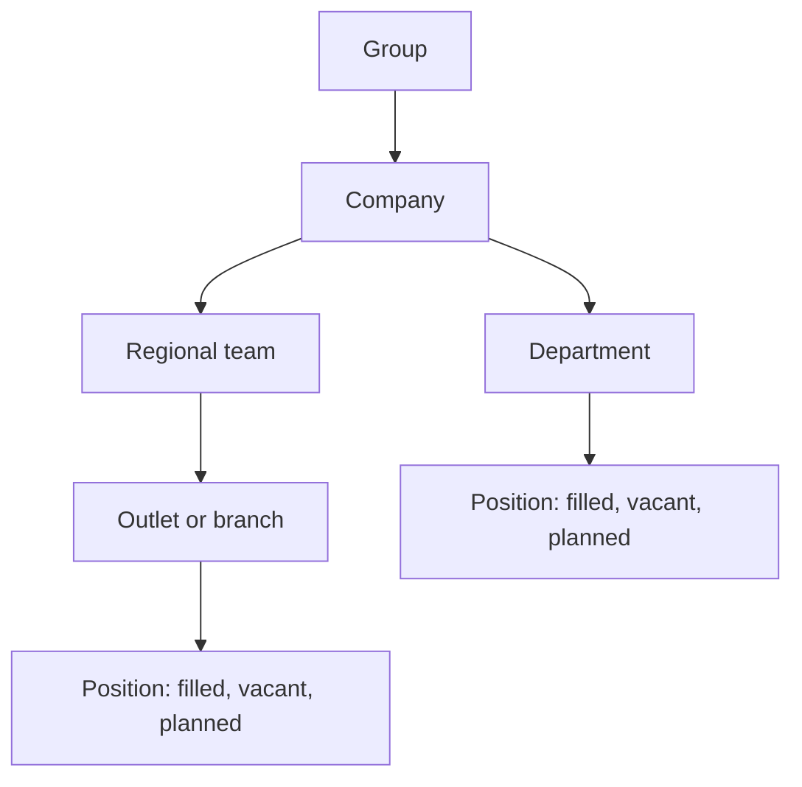
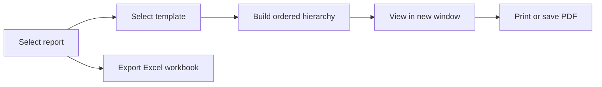
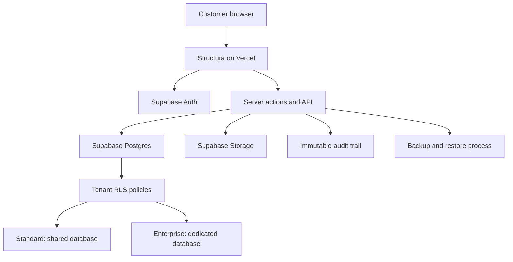
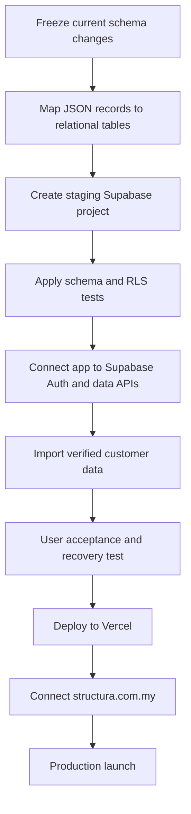

# Structura — Project Flow, Architecture and Logic

**System owner:** DMS INTELLIGENT SOLUTIONS SDN BHD  
**Package:** Live application source, version 24  
**Source commit:** `0fc14238a437978cd2bf3d495b6e921035ab37d0`  
**Prepared:** 2 September 2026

## 1. Purpose

Structura is a corporate registry and organisation-chart application for maintaining legal entities, ownership, shareholders, officers, outlets and branches, documents, users, audit history, and printable corporate reports.

This document distinguishes two architectures:

- **Current live version:** OpenAI Sites/Vinext application using Cloudflare D1, R2, and application-managed authentication.
- **Target commercial version:** Vercel application using Supabase Auth, Postgres, Storage, Row Level Security, and hybrid tenant isolation.

The source ZIP is a clean export of the current live version. It contains no passwords, environment files, uploaded documents, customer records, build output, dependency folders, or Git history.

## 2. Current Live System Architecture



### Main technology stack

| Layer | Current implementation |
|---|---|
| Front end | React 19, Next.js-compatible Vinext, TypeScript |
| Styling | Tailwind CSS, application CSS, shadcn-derived UI components |
| Hosting | OpenAI Sites on Cloudflare runtime |
| Database | Cloudflare D1/SQLite |
| File storage | Cloudflare R2 |
| Authentication | Application-managed users, PBKDF2 password hashes, secure HTTP-only session cookie |
| Spreadsheet processing | SheetJS `xlsx` |
| Reports | Browser-generated HTML preview and print-to-PDF |

## 3. Functional Navigation

| Navigation group | Functions |
|---|---|
| Overview | Dashboard and Registry Health score |
| Corporate Registry | Group structure; entities and ownership; shareholders; governance; documents and reminders |
| Organisation | Organisation chart maintenance |
| Reporting & Control | Reports and charts; change history |
| Administration | User maintenance; system settings; recovery centre |

The left menu is collapsible. When expanded, its sections are accordions so a user does not need to scroll through the complete menu.

## 4. User and Access-Control Logic

| Role | View | Print/export | Edit existing | Create/delete | User maintenance | Recovery |
|---|---:|---:|---:|---:|---:|---:|
| Master Admin | Yes | Yes | Yes | Yes | Yes | Yes |
| Admin Assistant | Yes | Yes | Yes | No | No | No |
| Viewer | Yes | Yes | No | No | No | No |

The interface hides actions that a role cannot use, and the APIs enforce the same restrictions server-side. An Admin Assistant update is rejected if record IDs show that a record was created or deleted. A Viewer cannot write registry or organisation-chart state.

## 5. Login and Session Flow



Security behaviour:

- Passwords are salted and derived using PBKDF2-SHA-256 with 100,000 iterations.
- The session token is stored in a `Secure`, `HttpOnly`, `SameSite=Lax` cookie.
- Inactive users and expired sessions are rejected.
- Master Admin can create users, update status/role, and issue a temporary password.
- Sign-in, sign-out, password changes, and administration events are recorded in the access log.

## 6. Registry Data Model

The current application stores registry information as versioned JSON state. The principal business objects are:



### Registry state contents

- Entities: name, registration number, incorporation date, business-opening date, type, status, activity, parent, share capital, shares, share class, and remark.
- Shareholders: company or individual.
- Ownership: direct percentage, share class, and number of shares.
- Officers: directors and company secretary with appointment date.
- Outlets/branches: parent entity, name, type, commencement date, status, address, state, and country.
- Documents: metadata, expiry date, size, and optional stored-file ID.
- Audit: timestamped business changes.
- Users: display data used by the administration interface; credentials remain in dedicated authentication tables.

## 7. Create and Edit Flow



The modal remains open during accidental outside clicks. Cancellation requires an explicit choice before entered data is discarded.

## 8. Save, Backup, and Recovery Logic



Protection rules in the current version:

- Before every overwrite, the previous D1 payload is saved in `structura_backups`.
- Up to 200 versions are retained per scope.
- A write that would replace a non-empty registry or chart with an empty one is blocked with HTTP 409.
- The browser keeps an emergency local copy when entities exist.
- On load, recoverable browser copies and cloud state are merged by record ID.
- Master Admin can list and restore dated versions from Recovery Centre.

Important: browser local storage is a recovery aid, not the production source of truth.

## 9. Organisation-Chart Logic

Organisation nodes use a parent-child structure. Supported levels are Group, Company, Department, Region, Outlet, and Position. A position may be Filled, Vacant, or Planned.



Each node stores its parent ID. Root nodes have no valid parent. Deleting a node removes its descendant subtree. Chart changes use a separate `org-chart` state scope and follow the same versioned-save protections as the corporate registry.

## 10. Ownership Logic

- Direct ownership is stored as a percentage between a shareholder and an entity.
- Total recorded ownership is summed by entity for Registry Health checks.
- Effective ownership is calculated across parent/entity paths for management display and Excel output.
- A complete entity ownership total is expected to equal 100%.
- Share class and shares are retained alongside percentage.

Before commercial launch, the effective-ownership algorithm should receive automated tests for circular holdings, cross-holdings, multiple paths, and rounding policy.

## 11. Report and Export Flow



Report designs: Classic, Executive, and Compact.

Corporate reports:

1. Entity names only.
2. Entity details and remarks.
3. Entity details, ownership names, and percentages.
4. Entities with outlets and branches, commencement date, and location.

Organisation reports:

1. Roles and departments.
2. Roles, departments, and employee name or `Vacant`.

Excel functions include a downloadable import template, workbook import, and full registry export. Supported input types are `.xlsx`, `.xls`, and `.csv`; the structured multi-sheet template is recommended.

## 12. Current API Map

| Endpoint | Method | Purpose | Access |
|---|---|---|---|
| `/api/auth?action=me` | GET | Current session | Any signed-in state |
| `/api/auth?action=logs` | GET | Access log | Master Admin |
| `/api/auth` | POST | Login, logout, password and user actions | Action-dependent |
| `/api/state?scope=registry` | GET/PUT | Load/save registry | Signed-in; write by permitted roles |
| `/api/state?scope=org-chart` | GET/PUT | Load/save chart | Signed-in; write by permitted roles |
| `/api/state` | POST | List/restore backups | Master Admin |
| `/api/files` | POST | Upload attachment | Master Admin |
| `/api/files?id=...` | GET | Download attachment | Signed-in |

## 13. Current Physical Storage

| Store | Data |
|---|---|
| D1 `app_state` | Current JSON payload for registry and organisation chart |
| D1 `structura_backups` | Up to 200 prior versions per scope |
| D1 `structura_users` | User records and password hashes |
| D1 `structura_sessions` | Active session tokens and expiry |
| D1 `structura_access_log` | Authentication and administrative events |
| D1 `stored_documents` | Attachment metadata |
| R2 | Uploaded document binary objects |
| Browser local storage | Emergency recovery copy only |

The current live application uses a shared logical key, `structura-group`. This is suitable for the present single-company deployment but is **not** the final isolation model for selling Structura to unrelated companies.

## 14. Target Commercial Architecture: Supabase + Vercel



### Recommended hybrid tenant model

- **Standard customers:** one shared Supabase project with `organization_id` on every tenant-owned table and enforced Row Level Security.
- **Enterprise customers:** a dedicated Supabase project/database selected through a secure tenant-routing layer.
- **Identity:** Supabase Auth user belongs to one or more organisations through `organization_memberships`.
- **Authorisation:** every request derives the active organisation from an authenticated membership; never trust an organisation ID supplied only by the browser.
- **Storage:** bucket object paths begin with the organisation ID, and Storage RLS applies the same membership rules.

### Target relational schema

| Table | Purpose |
|---|---|
| `organizations` | Customer/company tenant record |
| `organization_memberships` | User-to-tenant membership and role |
| `entities` | Legal entities and entity details |
| `shareholders` | Company and individual shareholders |
| `ownerships` | Direct holdings, percentage, shares, and class |
| `branches` | Outlets and branches under an entity |
| `officers` | Directors and company secretaries |
| `organization_nodes` | Group/company/department/region/outlet/position hierarchy |
| `documents` | Tenant-scoped attachment metadata and expiry |
| `audit_logs` | Actor, action, target, before/after values, timestamp |
| `registry_snapshots` | Restorable versioned registry snapshots |

The initial Supabase schema foundation exists in the selected Supabase project in Singapore. The current v24 application has not yet been rewired to use it, and Vercel deployment/custom-domain configuration remain a production migration milestone.

## 15. Tenant Isolation Rules for Public Launch

1. Every business table must include a non-null `organization_id`.
2. RLS must be enabled on every exposed table; no permissive anonymous policies.
3. A membership policy must verify `auth.uid()` belongs to the row's organisation.
4. Role checks must be enforced in the database/API, not only hidden in the interface.
5. Storage paths and policies must be tenant-scoped.
6. A standard tenant must never be able to choose or query another tenant ID.
7. Enterprise database credentials must remain server-only.
8. Audit records should be append-only for normal application roles.
9. Backups must be tested by restoration, not only by successful creation.
10. Production, staging, and development databases must be separate.

## 16. Recommended Production Migration Flow



New commercial tenants should start empty. Existing live data should be migrated only through an explicit, reconciled import. Count totals for entities, ownerships, branches, officers, documents, and chart nodes before and after migration.

## 17. Build and Run

Prerequisites: Node.js 22.13 or newer, npm, Linux tools `bash`, `flock`, `curl`, and GNU `timeout`.

```bash
npm run install:ci
npm run dev
```

Production validation:

```bash
npm run build
npm test
```

The current runtime expects Cloudflare bindings named `DB` for D1 and `BUCKET` for R2. Bootstrap credentials are supplied at runtime as `STRUCTURA_BOOTSTRAP_EMAIL` and `STRUCTURA_BOOTSTRAP_PASSWORD`; they are intentionally absent from the source archive.

## 18. Source Map

| Path | Responsibility |
|---|---|
| `app/page.tsx` | Main application, registry maintenance, import/export, recovery, users, navigation |
| `app/org-chart.tsx` | Organisation-chart CRUD and rendering |
| `app/report-centre.tsx` | Report selection, templates, preview, and PDF printing |
| `app/api/auth/route.ts` | Login/session/password/user API |
| `app/api/state/route.ts` | Registry/chart persistence, backup, and recovery API |
| `app/api/files/route.ts` | R2 upload/download API |
| `app/auth-server.ts` | Password, session, and audit helpers |
| `db/schema.ts` | D1 state and attachment metadata schema |
| `drizzle/0000_thin_vapor.sql` | Current generated D1 migration |
| `.openai/hosting.json` | Sites project and D1/R2 binding declarations |
| `tests/` | Build metadata and UI-component checks |

## 19. Release Readiness Status

| Area | Status |
|---|---|
| Current live v24 source | Included |
| Current D1/R2 implementation | Included |
| Authentication and access control | Implemented for current single-company deployment |
| Backup/recovery safeguards | Implemented in current version |
| Supabase schema foundation | Created separately; integration pending |
| Hybrid tenant routing | Design approved; implementation pending |
| Vercel production deployment | Pending |
| `structura.com.my` registration/DNS | Customer action and configuration pending |
| Production email sender | Decision/configuration pending |
| Security, RLS, restore, and penetration tests | Required before public sale |

## 20. Change-Safety Checklist

For every future enhancement:

- Create a database migration; do not replace or silently reset production data.
- Take and verify a restorable backup before deployment.
- Test against a staging copy with representative records.
- Run tenant-isolation and role-permission tests.
- Reconcile record counts and key totals after deployment.
- Keep rollback instructions with the release.
- Never ship secrets or customer data in a source archive.
- Require explicit confirmation for destructive imports, restores, and deletions.

---

Copyright © 2026 DMS INTELLIGENT SOLUTIONS SDN BHD. All rights reserved.
